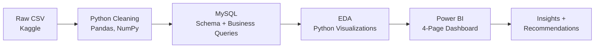

# 🚀 Startup Funding Analysis: Where Should an Early-Stage Founder Start?

**An end-to-end data analytics project: Python → MySQL → EDA → Power BI**


---

## 📌 Project Overview

The global startup ecosystem is growing fast, but a first-time founder has no easy way to answer three practical questions: **which city, which sector, and which investors should I focus on?**

This project analyzes **3,009 startup funding deals (January 2015 to early 2020)** and turns raw, messy funding records into a decision-support dashboard. The full pipeline covers data cleaning in Python, business analysis in MySQL, exploratory analysis, and a 4-page Power BI dashboard. Every page is built around one real question that a founder or an early-stage investor would ask.

---

## 🎯 Business Problem

| | |
|---|---|
| **Problem** | The startup ecosystem is growing fast, but it is hard for a new founder to know which sector, city, or funding stage gives the best chance of raising money. |
| **Stakeholder** | An early-stage founder who wants to start a company and raise Seed / Angel funding (the dashboard also serves investors and analysts studying the market). |
| **Objective** | Use funding data to support three decisions: where to start (city), what to build (sector), and whom to approach (investors and funding stage). |

### Key Business Questions

| # | Business Question | Where It Is Answered |
|---|---|---|
| 1 | Which sectors attract the most funding and deals? | SQL Q3, Q7 · Dashboard Page 3 |
| 2 | Which cities lead, and is funding concentrated in a few hubs? | SQL Q6 · Dashboard Page 3 |
| 3 | Which investors are most active, and are they the biggest ones? | SQL Q11, Q12 · Dashboard Page 4 |
| 4 | How did funding change over time (month-over-month and year-over-year)? | SQL Q5 · Dashboard Page 2 |
| 5 | What does a typical deal look like, and how concentrated is the money? | Dashboard Page 1 |
| 6 | Which funding stages dominate, and how large is a typical ticket per stage? | Dashboard Page 4 |

---

## 📊 Dataset

| | |
|---|---|
| **Source** | [Startup Funding dataset, Kaggle (Sudalai Rajkumar)](https://www.kaggle.com/datasets/sudalairajkumar/indian-startup-funding) |
| **Coverage** | Most deals are in Indian cities, but the data also includes startups located outside India (for example Menlo Park and other US locations), so the analysis is not limited to one country |
| **Period** | January 2015 to early 2020 (2020 contains only the first quarter) |
| **Records** | 3,044 raw rows → **3,009 deals** after cleaning |
| **Key columns** | Date, Startup Name, Industry Vertical, SubVertical, City Location, Investors Name, Investment Type, Amount |

---

## 🔄 Project Workflow



## 🛠️ Tools & Skills Demonstrated

| Area | What was used |
|---|---|
| Data cleaning | Python, Pandas, NumPy, regex, IQR outlier check |
| SQL | MySQL, CTEs, window functions (`SUM() OVER`, `LAG`), `CASE` pivots, joins, `HAVING` |
| EDA | Pandas, Matplotlib, Seaborn |
| Dashboard | Power BI, DAX measures, Date table, slicers, KPI cards |
| Business thinking | Problem framing, KPI selection, insight → recommendation, stating assumptions |

---

## 📁 Repository Structure

```text
startup-funding-analysis/
│
├── 00_Data/
│   ├── raw_data/                  # Original Kaggle CSV (startup_funding.csv)
│   └── cleaned_data/              # Cleaned CSV used for SQL and Power BI
│
├── 01_Business_Understanding/     # Problem statement, objective, stakeholder, questions
├── 02_Data_Understanding/         # Data source, columns, known quality issues
├── 03_Data_Cleaning/
│   └── data_cleaning.ipynb        # Full Python cleaning pipeline
│
├── 04_sql/
│   ├── schema_design.sql          # Database and table creation
│   └── sql_analysis.sql           # 12 business questions with insights
│
├── 05_EDA/
│   └── Data_Visualization.ipynb   # Exploratory charts answering business questions
│
├── 06_Dashboard/
│   └── startup_funding_dashboard.pbix  # Power BI dashboard
│
└── 07_Screenshots/
    ├── chart_images/              # EDA charts
    └── dashboard_images/          # Power BI dashboard pages
```

---

## 🧹 Data Cleaning (Python)

Notebook: [`03_Data_Cleaning/data_cleaning.ipynb`](03_Data_Cleaning/data_cleaning.ipynb)

| Problem found | Action taken |
|---|---|
| Dates stored as text, some malformed (`dd/mmyyyy`) | Repaired the format, parsed with `dayfirst=True`; 7 unparseable rows removed |
| Amount stored as text with commas, `N/A` and hidden characters | Custom cleaning function, converted to numeric |
| Amount currency | Divided by 65 (assumed ₹65 per $1) and reported in USD |
| ~32% of Amount values missing | Filled with the overall median (see Limitations) |
| Outliers in Amount | Identified with the IQR rule (283 deals) and **kept**, because they are real large funding rounds |
| Industry Vertical: **819 inconsistent labels** (`Ecommerce`, `E-Commerce`, `eCommece` …) | Explicit mapping dictionary (810 rules) → **26 clean groups**; missing values set to `Unknown` |
| Investment Type spelling variants (`Seed Funding`, `Seed Round` …) | Explicit mapping to standard stages (Seed, Seed / Angel, Series A, Private Equity …) |
| City name variants | Standardized the main ones (Bengaluru → Bangalore, Gurugram → Gurgaon, Delhi → New Delhi); missing set to `Unknown` |
| `Remarks` column (mostly empty) | Dropped |
| Missing Investors Name (24) and Investment Type (4) | Rows removed |
| Duplicate rows | Checked, none found |

---

## 🗄️ SQL Analysis (MySQL)

Files: [`schema_design.sql`](04_sql/schema_design.sql) · [`sql_analysis.sql`](04_sql/sql_analysis.sql)

The cleaned CSV was loaded into a `startup_funding` table. Each query answers a business question and ends with a written insight.

| # | Business question | Technique |
|---|---|---|
| Q1 | How much of the Amount column is missing or zero, and where? | CTE, `CASE` |
| Q2 | Is SubVertical consistent with Industry Vertical? | CTE, `HAVING` |
| Q3 | What share of total funding does each industry contribute? | Window function |
| Q4 | Top 5 sub-verticals by funding | CTE |
| Q5 | Month-over-month funding growth: which months boomed or slumped? | `LAG` |
| Q6 | How much do the top 5 cities contribute? | Window function |
| Q7 | Which industry attracts the most funding and deals? | Aggregation |
| Q8 | Drill-down: sub-verticals by funding and deal count | Multi-column `GROUP BY` |
| Q9 | Which industries show declining funding year after year? | `CASE` pivot |
| Q10 | Top 10 startups by funding | Aggregation |
| Q11 | Are the most active investors also the biggest? | Aggregation |
| Q12 | How much do the top 5 investors contribute, and where do they invest? | CTE, `JOIN` |

**Highlights**
- **Bangalore alone contributes about 48.6%** of total funding, and the top 5 locations together contribute roughly 80%.
- **One deal in the Bike Taxi sub-vertical is about 60M**, close to 10% of all funding in the dataset, which shows how much a single deal can move a sector total.
- **The most active investor label is "Undisclosed Investors" (80 deals)**, while the investor with the highest total funding made only 2 deals. Active and big are not the same thing.

---

## 📈 Exploratory Data Analysis

Notebook: [`05_EDA/Data_Visualization.ipynb`](05_EDA/Data_Visualization.ipynb) · Charts: [`07_Screenshots/chart_images/`](07_Screenshots/chart_images/)

Used visualizations to check the SQL findings and understand distributions, trends, and sector, city and investor patterns before building the dashboard.

---

## 📊 Power BI Dashboard

The dashboard has **4 pages**, and each page answers one question a founder or investor would ask.

### Page 1: Startup Funding Analysis (Overview)
> **Question:** *How big is this market, and does the average deal represent a typical deal?*


- KPI cards: total funding, total deals, startups funded, average and median deal size.
- Deal-size buckets show how funding is split between many small deals and a few large ones.
- Funding trend, top industries, and top cities at a glance.

### Page 2: Funding Trends Over Time
> **Question:** *Is funding growing or slowing, and does any period stand out?*


- Funding and deal count by year, plus a month-of-year view.
- Year-over-year growth KPI and a quarter-wise table to check spikes and drops.

### Page 3: Where the Money Goes: Industries and Cities
> **Question:** *Which sector and which city should a founder focus on, and is funding concentrated?*


- Industries ranked by both total funding and deal count.
- Cities ranked by funding, with each city's percentage share of total funding.

### Page 4: Who Invests and at What Stage
> **Question:** *Which investors are active, and at which funding stage does money flow?*


- Most active investors by deal count and the share of funding from undisclosed investors.
- Funding and deal count by investment type, plus median deal size per stage.

---

## 🔍 Key Insights

| What the data shows | What it does **not** prove |
|---|---|
| **Funding is concentrated in a few large deals.** About 97% of deals are under 1M but bring only about 36% of funding, while 13 deals (0.4%) in the 5M to 20M range bring about 37%. The average deal (about 199K) is roughly 7 times the median (about 27K). | That the "typical" startup receives the average amount. Most do not. |
| **2017 was the peak year (about 166.6M).** Funding zigzags: about 140M (2015), 70M (2016), 166.6M (2017), 70M (2018), 146M (2019). | Why funding rises and falls. No cause is tested here. |
| **Deal count fell sharply** (about 990 in 2016 to about 106 in 2019) while funding stayed high, so deals became fewer but larger. | That investors became more selective. It could also be lower data coverage in later years. |
| **Bangalore leads by a wide margin** (about 48% of funding). Mumbai, Gurgaon and New Delhi follow at comparable levels. | That Bangalore is the best place for every founder. Funding received is not startup success. |
| **Retail & E-commerce is the largest sector by funding** (about 250M), followed by Transportation & Logistics, Technology & Software, and Financial Services. | That these sectors are better to start in. The size also depends on how industries were grouped (see Limitations). |
| **Seed and Private Equity dominate deal counts**, and Private Equity takes by far the largest share of funding. | Which stage suits a first-time founder without checking ticket sizes per stage. |
| **Most active ≠ biggest.** Well-known names such as Indian Angel Network, Kalaari Capital and Sequoia Capital are among the most active, but the biggest total ticket came from an investor with only 2 deals. | Investor quality or returns. |

---

## 💡 Recommendations for an Early-Stage Founder

These are **data-supported starting points, not guarantees**.

1. **Location:** Bangalore has the deepest funding pool. Delhi-NCR (Gurgaon, New Delhi) and Mumbai are strong alternatives, which is useful for founders who want a lower-competition hub.
2. **Sector:** Retail & E-commerce, Technology & Software, and Transportation & Logistics attract the most money. Validate demand before choosing a sector, because funding volume does not equal startup success.
3. **Investors:** Target investors that appear repeatedly in early-stage deals (angel networks and seed-focused funds) instead of those who write one very large cheque.
4. **Expectations:** Plan around the **median** deal size, not the average. A few very large deals inflate the average.

---

## ⚠️ Assumptions & Limitations

- **Currency:** Amounts were divided by a fixed rate of ₹65 per $1 and shown in USD. A single rate across 2015 to 2020 is an approximation.
- **Missing amounts:** About 32% of deals had no disclosed amount and were filled with the overall median (about 26.9K). This affects the median deal size and the "under 1M" bucket most. Funding totals include roughly 4% imputed value.
- **Industry grouping:** 819 raw labels were mapped manually into 26 groups. Broad labels such as *Consumer Internet* were grouped under *Retail & E-commerce*, which makes that category larger.
- **SubVertical** is inconsistent (the same sub-vertical appears under several industries), so main insights use Industry Vertical and SubVertical is used only for drill-downs.
- **Cities and startup names** are only partly standardized, so the unique startup count is approximate. Some funding is tagged `Unknown`.
- **2020** contains only the first quarter, so it cannot be compared with full years.
- **Undisclosed investors** are the single most frequent investor label, which limits investor-level analysis.
- **Funding is not success.** The data shows who received money, not who survived or grew.

---

## ▶️ How to Reproduce

1. Clone the repository and install `pandas`, `numpy`, and `jupyter`.
2. Run `03_Data_Cleaning/data_cleaning.ipynb` (update the file path at the top) to generate the cleaned CSV.
3. In MySQL, run `04_sql/schema_design.sql`, then import the cleaned CSV into the `startup_funding` table.
4. Run `04_sql/sql_analysis.sql` to reproduce the business queries.
5. Open `06_Dashboard/startup_funding_dashboard.pbix` in Power BI Desktop and refresh the data source.

---

## 🚀 Future Improvements

- Add a flag for imputed amounts and report the median on **disclosed deals only**.
- Add an Investment Type filter to the industry and city page to show **Seed / Angel funding by sector and city**.
- Split multi-investor cells so each investor is counted separately.
- Finish city and startup-name standardization.
- Add a deal-level drill-through page for large deals.

---

## 👤 Author

**Avneesh** · Aspiring Data Analyst

[](https://github.com/codebyavneesh)
[](https://www.linkedin.com/in/codebyavneesh)

*If you found this project useful, feel free to star ⭐ the repository and share feedback.*
